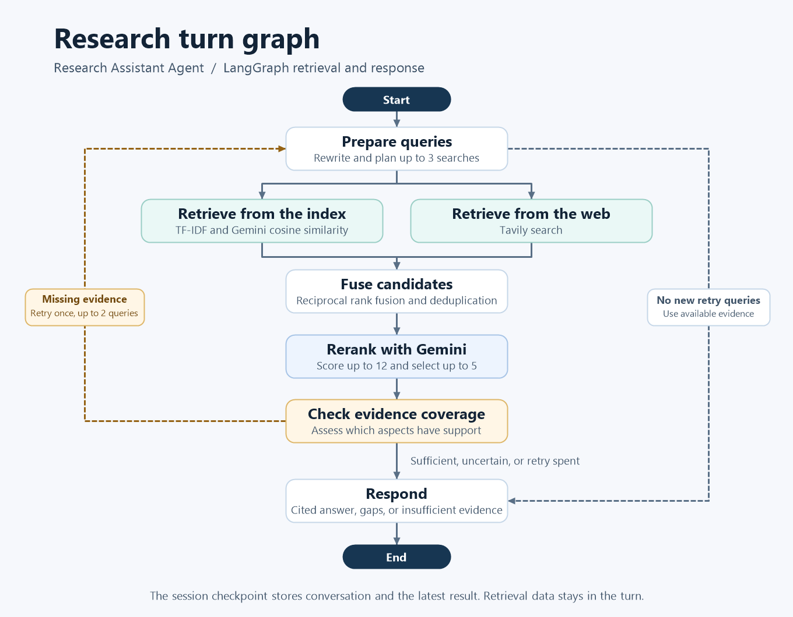

# Research Assistant Agent

A multi-turn research assistant built with LangGraph, Gemini, and Tavily. It rewrites questions for search, ranks evidence from the bundled knowledge base and the web, and generates cited answers.

[Hosted web demo](https://research-assistant-agent-ten.vercel.app/) · [Two-turn demo notebook](demoNotebook.ipynb)

## Architecture



- **Query preparation** resolves follow-up references using recent conversation and produces up to three standalone search queries. Search providers receive only the prepared queries.
- **Retrieval** runs local TF-IDF and Gemini embedding similarity over the 10 bundled documents, alongside Tavily search. Document vectors are cached within the running graph. A provider failure leaves results from the other paths available.
- **Ranking** fuses ranked results, deduplicates sources, and asks Gemini to score up to 12 candidates. It selects up to five evidence snippets and validates the resulting citation numbers.
- **Coverage** allows one targeted retry with up to two new queries and carries forward earlier evidence. If evidence remains incomplete, the response names the gaps. A reranker failure leaves coverage uncertain.
- **State** separates the in-memory session checkpoint from the stateless turn graph. Conversations keep their message history and latest answer and sources. Query plans, candidates, and retry data stay in the turn. Server logs include stage timings, counts, and fallback categories.

## Run locally

Create a Python virtual environment, activate it, and install the backend dependencies.

```bash
python -m venv .venv
# Linux/macOS
source .venv/bin/activate
# Windows PowerShell
.venv\Scripts\Activate.ps1
pip install -r requirements.txt
```

Create a local `.env` file in the project root. Use a Gemini key for rewriting, embeddings, reranking, and cited answers. Set a Tavily key to enable web evidence.

```dotenv
GOOGLE_API_KEY=your_google_api_key_here
TAVILY_API_KEY=your_tavily_api_key_here
```

Start the CLI with `python main.py`. Enter a research question, use `new` to start a fresh session, or use `quit` to exit.

For the web UI, run the API and frontend in separate terminals.

```bash
uvicorn api:app --reload
```

```bash
cd frontend
npm install
npm run dev
```

Open [the local web UI](http://localhost:5173). Send `POST /api/research` requests with `topic` and `thread_id` to receive `answer`, `sources`, and `thread_id`. Reuse the thread ID for follow-ups within the same API process.

## Deploy a Vercel preview

1. Import the repo into a FastAPI project with the repository root as its root directory. The Vercel configuration points to `api:app` and gives the function 90 seconds on Fluid compute. Set `GOOGLE_API_KEY` and `TAVILY_API_KEY` on this backend project.
2. Use `frontend` as the root directory of the Vite project. Set its `VITE_API_URL` to the deployed API origin. Add the frontend preview or production origin to `RESEARCH_ALLOWED_ORIGINS` on the backend, using a comma-separated list for multiple origins.
3. Protect `POST /api/research` with a fixed window of five requests per IP per 60 seconds. On the backend project, configure this as a [Vercel Firewall rule](https://vercel.com/docs/vercel-firewall/vercel-waf/rate-limiting) with a `429` action. For API-generated `429` responses that include CORS and `Retry-After`, set `UPSTASH_REDIS_REST_URL` and `UPSTASH_REDIS_REST_TOKEN` on the backend to use the built-in shared counter. Use one limiter for this endpoint.

The API gives each research turn a 75-second budget and reserves time for a response. It can skip an evidence retry when time is short and use the evidence already gathered. Chat history is temporary and tied to the backend instance.

Start with a fresh rate-limit window. Check the preview with a new question, a follow-up, and a small concurrent batch. The probe uses three simultaneous requests by default and reports timings, HTTP errors, rate limits, and whether each answer contains valid citation numbers. Its p95 describes this small sample. Check the backend logs for provider fallbacks and review the generated answers separately.

```bash
python -m evaluation.api_check https://your-api.vercel.app
```

If an answer lists sources but says Gemini reached its rate limit, search the backend's Vercel runtime logs for `research_provider_failed=gemini stage=respond reason=http_429`. Check the model's request and token limits for the backend key's project in Google AI Studio. Retry after the quota window resets. Keys from the same Gemini project share its limits. A log with `research_fallback=answer_failed reason=invalid_citations` means the model returned an answer whose citations failed validation.

## Run the notebook

From the repository root, install Jupyter in the same environment as the backend and open the notebook.

```bash
python -m pip install notebook ipykernel
jupyter notebook demoNotebook.ipynb
```

Run all cells to trace two turns and run the simulated benchmark with no credentials. The notebook uses deterministic providers by default and shows the prepared queries, ranked evidence, coverage decision, sources, and checkpoint fields. Set `USE_LIVE_PROVIDERS = True` in the setup cell to use Gemini and, when configured, Tavily for the two turns. The benchmark cell always runs the offline simulation.

## Verify retrieval

Open the [evaluation notebook](evaluationNotebook.ipynb) to run the offline checks, opt into live benchmarks, and review answers against their evidence.

```bash
python -m unittest discover -s tests -v
python -m evaluation.retrieval_benchmark
python -m evaluation.retrieval_benchmark --smoke
python -m evaluation.retrieval_benchmark --live
```

The unit tests and default benchmark run offline with deterministic providers. The benchmark uses 24 labeled cases, including exact terms, paraphrases, follow-ups, and three out-of-corpus questions. It compares raw-topic TF-IDF, first-round hybrid ranking, and final selected evidence. Recall@5 and nDCG@5 use the 21 answerable cases. Out-of-corpus results and latency are reported separately.

Use `--smoke` with Gemini and Tavily credentials to check the live provider path, including answer generation. Use `--live` with Gemini credentials to measure retrieval on the fixed local corpus. The quality gate requires both ranking metrics to meet or exceed the TF-IDF baseline and the provider path to complete without fallbacks.

### Recorded live benchmark

- Raw-topic TF-IDF scored **0.619 Recall@5** and **0.601 nDCG@5**.
- First-round hybrid ranking scored **1.000 Recall@5** and **0.982 nDCG@5**.
- Final evidence selection scored **0.929 Recall@5** and **0.948 nDCG@5**. It returned evidence for one of three out-of-corpus questions, compared with three before reranking.
- Final retrieval averaged **22.9 seconds**, with a **64.1-second p95**. The run deliberately spaced Gemini calls, and response generation used a stub.

One Gemini query rewrite returned HTTP 504 after retry, so the full run did not pass the strict quality gate. The same case passed on an isolated replay without a fallback. The live Gemini and Tavily smoke test passed.
